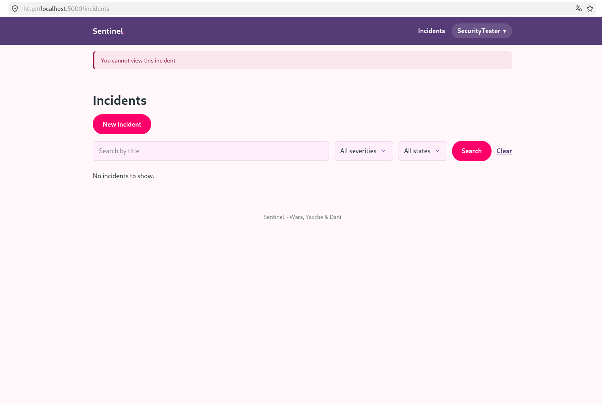
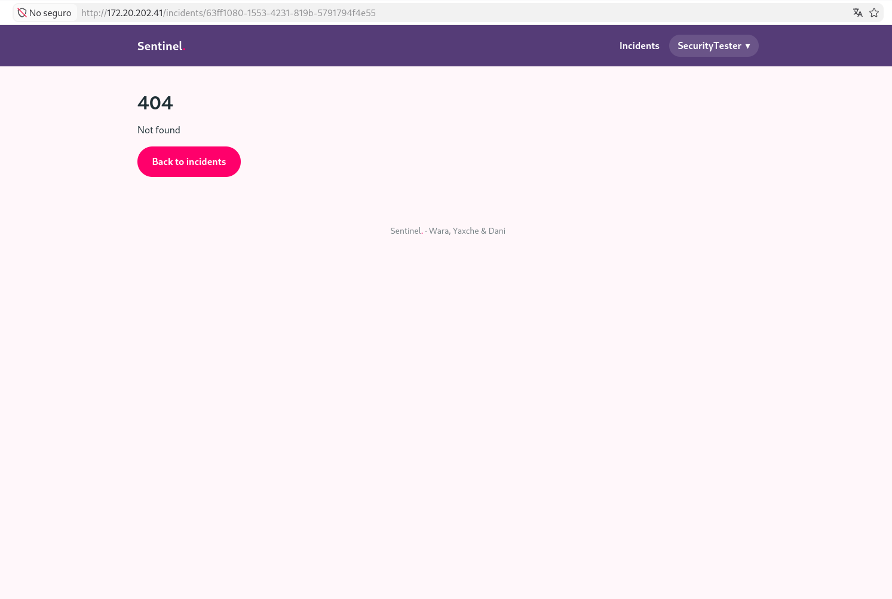
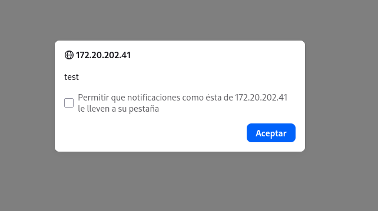

<div align="center">

# <span style="color:#1F4E79">Sentinel Report</span>

<span style="color:#2E75B6">**Attack Surface, Authentication & Access Control · Project Sentinel, Phase 2**</span>

*Nexus Digital Solutions · internal incident tracker*

</div>

| | |
| :--- | :--- |
| **Programme** | Informazioaren teknologien inguruneetan zibersegurtasun |
| **Module** | EKOS |
| **Authors** | Daniel Alvarez · Yaxche Alvarez · Wara Pacheco |
| **Date** | 22/11/2026 |

---

## Index

1. [Phase Overview](#1-phase-overview)
   - [1.1 Context](#11-context) · [1.2 Objectives](#12-objectives) · [1.3 Summary of results](#13-summary-of-results)
2. [Incident review](#2-incident-review)
   - [2.1 INC-2026-001: description](#21-inc-2026-001-description) · [2.2 Reproduction steps](#22-reproduction-steps) · [2.3 Root cause](#23-root-cause)
3. [Attack Surface](#3-attack-surface)
   - [3.1 Endpoint inventory](#31-endpoint-inventory) · [3.2 Input classification](#32-input-classification)
4. [Authentication](#4-authentication)
   - [4.1 Password storage](#41-password-storage)
   - [4.2 Login, logout and sessions](#42-login-logout-and-sessions)
     - [4.2.1 Login](#421-login)
     - [4.2.2 Session](#422-session)
5. [Authorization](#5-authorization)
   - [5.1 Roles](#51-roles) · [5.2 Single authorization mechanism](#52-single-authorization-mechanism) · [5.3 Server-side enforcement](#53-server-side-enforcement)
6. [Fix verification](#6-fix-verification)
   - [6.1 INC-2026-001 reproduction after the fix](#61-inc-2026-001-reproduction-after-the-fix)
   - [6.2 Additional test scenarios](#62-additional-test-scenarios)
     - [6.2.1 Path of transversal attack by dictionary guess of the web routes](#621-path-of-transversal-attack-by-dictionary-guess-of-the-web-routes)
     - [6.2.2 SQL Injection](#622-sql-injection)
     - [6.2.3 Session hijacking attack](#623-session-hijacking-attack)
     - [6.2.4 XSS](#624-xss)
     - [6.2.5 Access tests on other routes](#625-access-tests-on-other-routes)
7. [Identified risks, including IDOR](#7-identified-risks-including-idor)
   - [7.1 Cross-Site Request Forgery (CSRF)](#71-cross-site-request-forgery-csrf)
   - [7.2 Uploaded Files](#72-uploaded-files)
   - [7.3 Cross-Site Scripting (XSS)](#73-cross-site-scripting-xss)
   - [7.4 Cookie Hijacking](#74-cookie-hijacking)
   - [7.5 Server-side requests to URLs chosen by the user (SSRF)](#75-server-side-requests-to-urls-chosen-by-the-user-ssrf)
   - [7.6 Apache error pages not handled](#76-apache-error-pages-not-handled)
   - [7.7 No rate limits or max number of attempts](#77-no-rate-limits-or-max-number-of-attempts)
   - [7.8 Missing security headers](#78-missing-security-headers)
   - [7.9 Open registration](#79-open-registration)
   - [7.10 Source link with an unchecked scheme](#710-source-link-with-an-unchecked-scheme)
   - [7.11 default_severity cookie](#711-default_severity-cookie)
   - [7.12 No security logging](#712-no-security-logging)
8. [References](#8-references)

---

## 1. Phase Overview

### 1.1. Context

Sentinel is the internal incident tracker used by Nexus Digital Solutions. Version 1 is already deployed and used daily by employees.

The SOC Manager, Nerea Agirre, reported incident **INC-2026-001:** by changing a number in the URL, users could access incidents belonging to other employees, including client data. This was an IDOR (Insecure Direct Object Reference), a type of broken access control.

The incident also revealed that the application's attack surface had never been mapped and that clear access rules were needed. This phase addresses the root causes, not just the reported URL.

### 1.2. Objectives

1.  Map the attack surface: endpoints, inputs, parameters and files.

2.  Implement authentication: login, logout and session handling.

3.  Implement authorization with three roles: Employee, Analyst and Admin.

4.  Fix every IDOR-class problem, not only the reported one.

5.  Store passwords securely.

### 1.3. Summary of results

This phase started with incident INC-2026-001, reported by the SOC Manager. By changing the ID in the URL, a user could read incidents belonging to other employees, including client data. The cause was an IDOR: a missing permission check when an incident was loaded. This raised a wider question: if one route did not check permissions, could other routes and inputs also be exposed? Since the attack surface of Sentinel had never been reviewed, we first mapped its routes and all the inputs that reach the application.

With the attack surface mapped, we focused on the most urgent problems: permissions, authentication and sessions. We created three roles (Employee, Analyst and Admin) and moved all permission checks into a single function that denies access by default. Passwords are now stored as salted hashes instead of plain text, and sessions are protected with safer cookie settings and an expiry time.

Reviewing the other application inputs revealed vulnerabilities beyond the original incident. Our tests confirmed some of them, such as stored XSS in comments and session hijacking using a copied cookie. We also tested for SQL injection but found no evidence of it. These findings, along with the other open risks, are described in section 7.

---

## 2. Incident review

### 2.1. INC-2026-001: description

<span style="color:#2E75B6">**Reported by:**</span> Nerea Agirre, SOC Manager of Nexus Digital Solutions.

<span style="color:#2E75B6">**Type:**</span> IDOR (Insecure Direct Object Reference), a case of broken access control.

<span style="color:#2E75B6">**What happens:**</span> a logged-in user changes the identifier of an incident in the URL and the application shows an incident that belongs to another employee.

<span style="color:#C00000">**Impact:**</span> loss of confidentiality. Incidents contain client data, so any employee could read information that was not theirs.

The problem is not the identifier in the URL. The problem is that the application loaded the incident without checking whether the user was allowed to see it. For this reason the fix is not limited to the reported URL: every route that receives an identifier has to be reviewed.

### 2.2. Reproduction steps

We will need two valid accounts: Employee A (the ticket owner) and Employee B (a different user without access to the ticket).

<span style="color:#2E75B6">**Steps:**</span>

1.  Log in to the application as Employee A.

2.  Create a new ticket.

3.  Save the ticket ID. It appears in the URL as a parameter, for example:

> `http://172.20.202.41/incidents/63ff1080-1553-4231-819b-5791794f4e95`

4.  Log out and log in as Employee B.

5.  In the same browser, open the saved URL.

<span style="color:#548235">**Result**</span>

When another user opens a saved URL for an incident they do not own, the application shows an error message instead. Changing or reusing an incident ID in the URL does not allow access to another user's incident. Therefore, INC-2026-001 is fixed.

<p align="center"></p>

### 2.3. Root cause

An IDOR happens when an application uses an ID provided by the user, such as the one in the URL, without checking if that user has permission to access the object. Since the user can change the ID, they could access another incident just by changing the URL, if the server does not check their permissions.

Authentication and authorization are different. Authentication checks who the user is, while authorization checks what they can access. With an IDOR, the user is logged in, but the application does not check if they have permission to access that specific incident.

<span style="color:#548235">***Why it does not happen in Sentinel:***</span>

1.  Sentinel checks permissions before showing an incident. It does not trust the ID alone.

2.  The user and their role are managed by the server. current_user() gets the user ID from the signed session cookie and loads the user and their role from the database. This prevents users from changing their own role.

3.  All access checks are handled by authorize(). It allows access only if the user owns the incident or has a role that gives them permission. Otherwise, access is denied.

The UUID adds an extra layer of protection because it is much harder to guess than a simple number like 1, 2 or 3. However, it does not prevent IDOR by itself. A valid UUID can still be shared or exposed in browser history or logs. The real protection is the authorization check.

---

## 3. Attack Surface

### 3.1. Endpoint inventory

We list all the routes from the Sentinel project with the command:

```bash
flask routes
```

We also checked this with ffuf in section 6.2.1, where a wordlist containing hidden routes was used. The results included valid Flask routes that do not cause errors when accessed, but do not expose private information.

For this reason, we use the output of flask routes to map the application's attack surface, rather than treating every route found by ffuf as a security risk.

| **Route** | **Method** | **Auth required** | **Inputs** | **Accesses object by ID** |
| :--- | :--- | :--- | :--- | :--- |
| `/` | GET | No | None | No |
| `/login` | GET | No | None | No |
| `/login` | POST | No | form: email, password | No |
| `/register` | GET | No | None | No |
| `/register` | POST | No | form: name, email, password | No |
| `/logout`[^1] | GET | No | None | No |
| `/password` | GET | Yes | None | No |
| `/password` | POST | Yes | form: current_password, new_password | No |
| `/incidents` | GET | Yes | query: title, severity, state; cookie: default_severity | No |
| `/incidents/new` | GET | Yes | None | No |
| `/incidents/new` | POST | Yes | form: title, description, severity, source_url; file: file | No |
| `/incidents/<uuid:incident_id>` | GET | Yes | URL: incident_id | Yes (incident) |
| `/incidents/<uuid:incident_id>/assign` | POST | Yes | URL: incident_id; form: analyst_id | Yes (incident) |
| `/incidents/<uuid:incident_id>/close` | POST | Yes | URL: incident_id | Yes (incident) |
| `/incidents/<uuid:incident_id>/comments` | POST | Yes | URL: incident_id; form: content | Yes (incident) |
| `/incidents/<uuid:incident_id>/attachment` | GET | Yes | URL: incident_id | Yes (incident and attachment) |
| `/users` | GET | Yes | None | No |
| `/users/<uuid:user_id>/role` | POST | Yes | URL: user_id; form: role | Yes (user) |

### 3.2. Input classification

We searched the source code with grep for the places where Flask reads user data (request.args, request.form, request.values, request.get_json, request.files, request.cookies, request.headers), for URL parameters such as /incidents/&lt;id&gt;, and for the use of the session.

Second, we ran the application and observed the requests in the browser developer tools (Network tab), using each role (Employee, Analyst, Admin). Then we compared both lists to check that every input found in the code appears in the application, and the other way around.

| **Input** | **Origin** | **Who controls it** | **Used for** |
| :--- | :--- | :--- | :--- |
| incident_id | URL path (&lt;uuid:&gt;) | User | Lookup of an incident (detail, assign, close, comment, attachment) |
| user_id | URL path (&lt;uuid:&gt;) | User | Lookup of the user whose role changes |
| filename[^2] | URL path (/static/) | Server | Serving a static file |
| title | Query string | User | In-memory filter; shown back in the search box |
| severity (filter) | Query string and cookie | User | In-memory filter |
| state | Query string | User | In-memory filter |
| email | Form body | User | SQL lookup (login), insert (register, create user) |
| password | Form body | User | Compared with the stored value (login), stored (register, create user) |
| name | Form body | User | Stored; copied into the session (user_name) and shown in the header |
| current_password, new_password | Form body | User | Password change |
| title, description(incident) | Form body | User | Stored and shown in the list and detail |
| severity (incident) | Form body | User | Stored as severity of the incident |
| source_url | Form body | User | The server requests it (urlopen); stored and shown as a link (href) |
| file (name, MIME type, content) | File upload | User | Written to disk; name and type are shown on the incident and on download |
| analyst_id | Form body | User | Decides who an incident is assigned to |
| content (comment) | Form body | User | Stored and rendered in the incident page |
| role | Form body | User | Decides the role of a new or existing user |
| comment.content, source_title (read back) | Database | Server | Rendered in the incident page |
| source_url(fetched by the server) | fetch_page_title in app/services/link_service.py | User | The server requests it (urlopen, SSRF); the title of the remote page is saved and shown, so a third party also feeds data into the app. Also shown as a link (href). |

<span style="color:#2E75B6">**Other entry points**</span>

Inputs that do not belong to a single route, or that reach the application without being a form field:

| **Entry point** | **Where it is read** | **Who controls it** | **Used for** |
| :--- | :--- | :--- | :--- |
| Session cookie (session, holds user_id and user_name) | current_user() in app/routes/common.py | Server signs it, the client carries it | Deciding who the user is, and therefore every permission |
| Cookie default_severity | list_incidents in app/routes/incidents.py | User | Default filter; converted with int() |
| Header Referer[^3] | Error handlers in app/routes/common.py(request.referrer) | User | Target of the redirect after any error |

---

## 4. Authentication

During Phase 1, Sentinel stored passwords in plain text. To fix this vulnerability, the team now stores a salted hash of each password instead of the password itself, using BCrypt. A hash cannot be reversed, so even if someone reads the database, they cannot get the original passwords. At login, the application hashes the password that the user types and compares it with the stored hash.

In Phase 2, login, logout and session management were improved to make user authentication more secure and protect access to the application.

### 4.1. Password storage

Bcrypt is applied with the following parameters:

1.  **Minimum password length:** 8 characters. This helps prevent the use of short and easily guessable passwords.

2.  **Maximum password length:** 72 bytes, due to a limitation of the bcrypt module we are using.

3.  **Dummy hash:** if the email does not exist, the application still checks a fake hash. This way the response time is similar, and an attacker cannot know which emails have an account.

```python
@staticmethod
def hash_password(password: str) -> str:
password_bytes = password.encode('utf-8')
salt = bcrypt.gensalt()
hashed = bcrypt.hashpw(password_bytes, salt)
return hashed.decode('utf-8')

@staticmethod
def verify_password(password:str, hashed:str)->bool:
password_bytes = password.encode('utf-8')
hash = hashed.encode('utf-8')
return bcrypt.checkpw(password_bytes, hash)
```

### 4.2. Login, logout and sessions

#### 4.2.1. Login

In Phase 1, the login process checked if the user existed and then compared the entered password with the one stored in the database. If everything was correct, the application rendered the template.

After implementing the BCrypt hashing module, the login process has changed to the following steps:

1.  The user sends their email and password through "POST /login". If either field is empty, the application returns a 400 error.

2.  The user is searched in the database using a parameterized query.

3.  The entered password is checked against the stored BCrypt hash (using verify_password method, see section 4.1).

4.  If the login fails, the application always returns the same 401 error: "Invalid email or password", regardless of whether the email or password was incorrect.

5.  If the email does not exist, the application still checks a fake hash to prevent response times from revealing which emails are registered.

6.  If the login is successful, the old session is cleared, the user information is saved in a new session, and the application redirects to "/incidents".

#### 4.2.2. Session

Currently these are the functions of the cookie:

- It is a signed cookie called session: the server detects any change, but the browser can read it.

- It stores only user_id and user_name (to show the name in the header).

- The role is never stored. On every request, current_user() reads the user and the role from the database.

- A role change applies on the next request; a deleted user is logged out.

In Phase1, Sentinel used Flask's default session: a signed cookie called session. The secret key was read from the environment, and no other cookie setting was configured, so Flask's defaults applied: HttpOnly on, Secure off, and no SameSite restriction. The session was not marked as permanent, so the cookie was deleted when the browser was closed, and the server applied no inactivity timeout.

After the Phase 2 review, the following changes were applied.

<span style="color:#2E75B6">**Cookie configuration**</span>

| **Setting** | **Value** |
| :--- | :--- |
| `SECRET_KEY` | Read from the environment, not from the code |
| `HttpOnly` | Always on: JavaScript cannot read the cookie |
| `SameSite` | Lax: not sent in POST requests from other sites |
| `Secure` | Controlled by SESSION_COOKIE_SECURE. Off, because Sentinel is served over HTTP without a certificate. It must be turned on when HTTPS is available |
| `PERMANENT_SESSION_LIFETIME` | 2 hours. <br>It sets how long the session lasts after the last request. |
| `SESSION_REFRESH_EACH_REQUEST` | True. <br>The cookie is renewed on every request, so the 2 hours count from the last activity (inactivity timeout). |
| `session.permanent` | True, **set in the code at login and registration.** Without it, the lifetime above does not apply and the cookie is deleted when the browser is closed. |

<span style="color:#2E75B6">**Expiry**</span>

The session now lasts 2 hours after the last request. This is set by PERMANENT_SESSION_LIFETIME, together with SESSION_REFRESH_EACH_REQUEST and session.permanent (see the table above). The cookie is no longer deleted when the browser is closed, and there is no absolute limit.

<span style="color:#2E75B6">**Session fixation**</span>

- session.clear() runs before the user is saved at login, so nothing from a previous session is carried over.

- With cookie sessions there is no server-side session id for an attacker to plant.

<span style="color:#2E75B6">**Logout**</span>

The "/logout" route now uses POST and calls "session.clear()" to remove the session and expire the cookie. In the first version, logout used a GET link, which allowed another website to log the user out through a link or an image. Now, GET requests to "/logout" return a 405 error.

---

## 5. Authorization

### 5.1. Roles

Sentinel has three roles. Each role is a class (Employee, Analyst, Admin) that extends User and answers yes/no questions called capabilities. The rest of the code never asks “what is your role?”, only “can you do this?”.

The role column of the user table is mapped to its class by ROLE_CLASSES. Every account created through /register is an Employee, and only an Admin can give another role.

| **Role** | <span style="color:#548235">**Can do**</span> | <span style="color:#C00000">**Cannot do**</span> |
| :--- | :--- | :--- |
| Employee | Report incidents. <br>View, comment on and download attachments of the incidents they created | See other people’s incidents. <br>Take, assign or close incidents. <br>Manage users |
| Analyst | See all incidents. <br>Take incidents. <br>Comment on and close the ones assigned to them | Manage users. <br>Assign an incident that belongs to another analyst |
| Admin | Manage users ( list, change roles). <br>Read every incident | Handle incidents (take, close, receive assignments). <br>Change their own role |

<span style="color:#2E75B6">**Permission matrix:**</span>

| **Route** | **Anonymous** | **Employee** | **Analyst** | **Admin** |
| :--- | :--- | :--- | :--- | :--- |
| `/, /login, /register` | <span style="color:#548235">yes</span> | <span style="color:#548235">yes</span> | <span style="color:#548235">yes</span> | <span style="color:#548235">yes</span> |
| `POST /logout` | <span style="color:#7F7F7F">yes (no effect)</span> | <span style="color:#548235">yes</span> | <span style="color:#548235">yes</span> | <span style="color:#548235">yes</span> |
| `/password` | <span style="color:#7F7F7F">redirect</span> | <span style="color:#548235">yes</span> | <span style="color:#548235">yes</span> | <span style="color:#548235">yes</span> |
| `GET /incidents` | <span style="color:#7F7F7F">redirect</span> | only their own | all | all |
| `/incidents/new` | <span style="color:#7F7F7F">redirect</span> | <span style="color:#548235">yes</span> | <span style="color:#548235">yes</span> | <span style="color:#548235">yes</span> |
| `GET /incidents/<id> and /attachment` | <span style="color:#7F7F7F">redirect</span> | only their own (else 404) | all | all |
| `POST /incidents/<id>/comments` | <span style="color:#7F7F7F">redirect</span> | on their own (else 404) | on their own and assigned ones | on their own (else 404) |
| `POST /incidents/<id>/assign` | <span style="color:#7F7F7F">redirect</span> | <span style="color:#C00000">404</span> | free one, or assigned to them (else 404) | <span style="color:#C00000">404</span> |
| `POST /incidents/<id>/close` | <span style="color:#7F7F7F">redirect</span> | <span style="color:#C00000">404</span> | only assigned to them (else 404) | <span style="color:#C00000">404</span> |
| `/users, /POST /users/<id>/role` | <span style="color:#7F7F7F">redirect</span> | <span style="color:#C00000">403</span> | <span style="color:#C00000">403</span> | <span style="color:#548235">yes</span> |

> <span style="color:#2E75B6">**Note.**</span> Sentinel has no route for an Admin to create users. The route (/users/new) was written, but we commented it out. Anyone can already create an Employee account at /register, and an Admin can change any role later at /users/&lt;id&gt;/role, so a second way to create users gives no benefit and only makes the attack surface bigger. The code of UserService.create_user is kept in case registration is closed in the future; in that case the route can be enabled again. Deleting users is also not implemented, to avoid orphan tickets: incidents point to the user who created them and to the analyst assigned to them

### 5.2. Single authorization mechanism

All decisions are taken in one function, in app/services/authorization.py. The model is RBAC: each user has one role, and the role decides which capabilities the user has (view_all_incidents(), handle_incidents(), admin_all_users()).

When the capability alone is not enough, authorize also checks that the user is the creator of the incident or its assigned analyst.

```python
authorize(user, action, incident=None) -> bool
```

- It is the only code that reads the capabilities and the only code that compares the creator or the assigned analyst of an incident.

- It denies by default: nobody logged in, an unknown action, or an action about an incident without the incident all return False.

- require(user, action, incident=None) calls authorize and raises AccessDeniedError when the answer is no. The status code is chosen only there: 404 when the action is about an incident (we do not confirm it exists) and 403 when there is only a role and no object (manage_users).

<span style="color:#2E75B6">**How the routes use authorization**</span>

Routes that do not depend on a specific object, such as "/users", use the "requires_permission(action)" decorator. We chose this approach because permissions are clearly defined above each route, the check runs on every request before the route code, and we avoid repeating the same checks in different functions. This also provides a single way to manage permissions instead of using scattered "if role ==" checks.

```python
@users_bp.get("/users")
@requires_permission(MANAGE_USERS)
def list_users(user):
```

On each request, the decorator performs three steps:

1.  If the user is not logged in, they are redirected to "/login" and the route is not executed.

2.  If the user is logged in but does not have the required permission, the application returns a 403 error and the route is not executed.

3.  If the user has permission, the route runs and receives the logged-in user as its first argument ("user"). There is no need to look up the user again.

Routes that access a specific incident work differently. They cannot use the same decorator because access depends on the incident itself, such as who created it or who it is assigned to. Instead, the service loads the incident and checks permissions in the same step through "get_incident()". This also ensures that missing incidents and incidents without permission return the same 404 error.

Other rules that are not directly related to resource access are handled by the user service. For example, users cannot change their own role, and every account created through "/register" is assigned the Employee role.

Authorization decisions are taken only in authorize(). The login check ("if the user is not logged in, go to /login") is repeated in the routes that do not use the decorator. This is not an authorization rule, but it could be moved to the decorator as an improvement.

### 5.3. Server-side enforcement

Authorization is enforced on the server, on every request and on every object. Hiding a button is only a convenience: the same rule is applied again when the request arrives.

| **Principle** | **How it is applied** |
| :--- | :--- |
| The role is never taken from the client | The session stores only user_id and the display name. <br>The user and role are loaded from the database on every request. <br>Registration always creates an Employee, and role changes are validated against ROLE_CLASSES. |
| Every object is checked | IncidentService.get_incident(user, id, action) loads each incident and checks permissions. <br>All incident operations use this method. |
| Permissions are checked in the service and route | `/users routes use @requires_permission(MANAGE_USERS), and UserService checks permissions again.` |
| Lists are filtered in the query | Employees only see their own incidents through get_by_user(user.id). <br>Users with list_all_incidents can see all incidents. |
| Browser input is validated | analyst_id must belong to an existing user who can receive assignments (be_assignee). <br>Invalid UUIDs are rejected, and Admins cannot change their own role. |
| Access denials are consistent | Missing and inaccessible incidents return the same 404 page. <br>Role-based restrictions return 403, and unauthenticated users are sent to login. <br>Denied requests never redirect. <br>Validation errors return to the previous application page. |

<span style="color:#2E75B6">**Control applied to each route**</span>

| **Route** | **Control** |
| :--- | :--- |
| `/, /login, /register, /logout` | Public. /register sets the role on the server. |
| `/password` | Logged-in user, only for their own account. |
| `GET /incidents` | Login; the scope depends on list_all_incidents and is applied in the query. |
| `/incidents/new` | Login; any user can report an incident. |
| `GET /incidents/<id>` | view_incident on that incident. |
| `GET /incidents/<id>/attachment` | download_attachment on that incident. |
| `POST /incidents/<id>/comments` | comment_incident on that incident. |
| `POST /incidents/<id>/assign` | assign_incident on that incident, and be_assignee on the chosen user. |
| `POST /incidents/<id>/close` | close_incident on that incident. |
| `/users, POST /users/<id>/role` | Login first, then manage_users (403 otherwise). |

---

## 6. Fix verification

### 6.1. INC-2026-001 reproduction after the fix

We will need two valid accounts: Employee A (the ticket owner) and Employee B (a different user without access to the ticket).

<span style="color:#2E75B6">**Steps:**</span>

1.  Log in to the application as Employee A.

2.  Create a new ticket.

3.  Save the ticket ID. It appears in the URL as a parameter, for example:

> `http://172.20.202.41/incidents/63ff1080-1553-4231-819b-5791794f4e95`

4.  Log out and log in as Employee B.

5. In the same browser, open the saved URL.

<span style="color:#7F7F7F">**Expected result:**</span>

Employee B cannot see the ticket, because it belongs to Employee A. The application denies access.

<p align="center"></p>

<span style="color:#548235">**Result:**</span>

When Employee B opens the saved URL, the application returns a 404 error. The page shows "404" and "Not found". The ticket content is not shown to Employee B.

This means the application does not reveal the ticket to a user who does not own it. The access control works as expected, and reusing an incident ID in the URL does not expose another user's incident.

<span style="color:#2E75B6">**Observation:**</span>

The error message should be improved to be more user friendly. A technical 404 page ("the object does not exist") can confuse the user. A clearer message would tell the user what happened and what to do, for example: "We could not find this incident. Please go back to your incidents list." The message should stay generic, so it does not confirm whether the incident exists.

### 6.2. Additional test scenarios

#### 6.2.1. Path of transversal attack by dictionary guess of the web routes

We attempted to guess the directory structure by a dictionary attack with the “ffuf” command as we can see in the file “E01” multiple web pages were found and we also saw that the web server did not have a limit of petitions per second so these type of attacks can be performed easily the used command for the attack is the next one:

```bash
ffuf -u http://172.20.202.41/FUZZ -w /usr/share/dirbuster/wordlists/directory-list-2.3-medium.txt -o resultados.json -of json
```

The ffuf command found some valid routes, but none of them showed private information. The server also did not limit the number of requests per second, so a scan like this is easy to run.

#### 6.2.2. SQL Injection

We attempted to make an SQLI in a field of an SQL query in order to exploit the vulnerability:

```sql
titulo','descripcion','1','1','2026-11-04 16:26:46',NULL); insert into test (test) values ('Hacked'); --
```

The text was saved as normal text and the table "test" did not change. The queries of Sentinel use parameters (%s), so the input is never joined to the SQL text. We found no SQL injection.

#### 6.2.3. Session hijacking attack

We tested whether a copied session cookie could be used to access another user's session.

We logged in as an Admin and copied the session cookie using the browser developer tools (Application tab). Then, we logged out, logged in as a normal user, replaced their session cookie with the copied Admin cookie and reloaded the page.

The application showed the Admin's session. The server accepted the cookie without asking for a password.

Since Sentinel uses HTTP instead of HTTPS, the data travels over the network without encryption. This makes it possible for an attacker on the same network to intercept the session cookie through a Man-in-the-Middle (MitM) attack and reuse it to access the victim's session.

#### 6.2.4. XSS

We logged in, opened an incident and entered the following content into the comment box.

```html
<script>alert("test")</script>
```

Then, we submitted the comment and reloaded the page.

A pop-up with the text "test" appeared. The pop-up appears every time someone opens the incident because the code is stored in the database and runs in other users' browsers as well. This is known as Stored XSS.

<p align="center"></p>

#### 6.2.5. Access tests on other routes

The test of section 6.1 was repeated on the other routes that receive an ID or are restricted by role. We did these tests in two ways: manually in the browser, and with automated tests. All of them gave the expected result.

Employee B, with the ID of an incident of Employee A:

- GET /incidents/&lt;id&gt;/attachment: 404

- POST /incidents/&lt;id&gt;/comments: 404

- POST /incidents/&lt;id&gt;/assign: 404

- POST /incidents/&lt;id&gt;/close: 404

Employee (no admin role):

- GET /users: 403

- POST /users/&lt;id&gt;/role: 403

---

## 7. Identified risks, including IDOR

After reviewing the different types of input handled by Sentinel, the following risks were identified.

### 7.1. Cross-Site Request Forgery (CSRF)

Sentinel uses session cookies, which the browser sends automatically, even when a request comes from another website. This means that a malicious website could send requests using an authenticated user's session.

For example, an Employee could be forced to create or modify incidents, while an Admin could be tricked into performing actions such as changing a user's role.

SameSite=Lax reduces this risk, because the browser does not send the cookie in POST requests from other sites, but it does not replace a CSRF token.

### 7.2. Uploaded Files

File uploads are one of the weakest points in Sentinel The application accepts any file type and has no size limit. Very large files could fill the disk or slow the server.

Files are also saved with the extension provided by the user and later served using send_file. A file such as .html or .svg could contain JavaScript that runs in the browser of anyone who opens it, potentially using their session.

### 7.3. Cross-Site Scripting (XSS)

Jinja escapes template content by default, so titles and descriptions are displayed as text. However, comments are displayed using the `|safe` filter in incident.html, which disables this protection.

This means any user who can write a comment could add HTML or JavaScript that runs in the browser of anyone who opens that incident, including Analysts and Admins.

The HttpOnly flag prevents JavaScript from reading the session cookie, but it does not stop scripts from performing actions using the user's session.

### 7.4. Cookie Hijacking

If an attacker steals a session cookie, they can use it to act as that user. Sentinel currently uses HTTP instead of HTTPS, and the Secure flag is disabled. This means the cookie can be sent without encryption.

Another issue is that sessions are stored in the browser, so the server cannot directly invalidate a stolen cookie. A copied cookie can remain valid after logout until it expires.

The session expires after 2 hours of inactivity, but there is no absolute expiration time. As long as the user remains active, the session keeps being renewed.

### 7.5. Server-side requests to URLs chosen by the user (SSRF)

When an incident includes a source link, the server visits that URL to retrieve its title using fetch_page_title.

The URL is provided by the user and is not validated. This could allow an attacker to make the server request internal addresses that are not accessible from outside. The retrieved page title is then stored with the incident.

### 7.6. Apache error pages not handled

Some errors are not handled by Sentinel. For example, an unknown URL or an unsupported HTTP method may show the default Apache error page instead of the application's own error page.

This can reveal which server software is being used and makes the application look unfinished.

### 7.7. No rate limits or max number of attempts

Sentinel has no rate limit or account lockout, so an attacker can try different passwords repeatedly.

The login process always returns the same error message for an incorrect email or password, and the response time is also similar. However, the registration form displays "Email already registered", allowing anyone to check which email addresses have an account.

### 7.8. Missing security headers

Sentinel does not currently send important security headers such as Content-Security-Policy, X-Frame-Options or X-Content-Type-Options.

Without these headers, the application has less protection against certain attacks. For example, another website could display Sentinel inside a frame (clickjacking), and there are no additional browser restrictions to limit the impact of injected scripts.

### 7.9. Open registration

Anyone who can access /register can create an Employee account.

Once registered, users can upload files, write comments and make the server visit URLs. This means that the other risks described in this section could potentially be exploited by anyone with network access to Sentinel.

### 7.10. Source link with an unchecked scheme

The source link of an incident is displayed without checking its URL scheme. This means a link starting with javascript: could run code when someone clicks on "Open link" (this needs further testing).

### 7.11. default_severity cookie

Sentinel also uses a regular cookie called default_severity. The user can change its value, and it does not have the HttpOnly, Secure or SameSite flags. These settings are only applied to the session cookie.

The risk is low because this cookie is only used to filter incidents, and its value is converted to a number.

### 7.12. No security logging

Sentinel does not currently record important security events, such as failed login attempts or role changes (this needs to be confirmed).

Without these logs, it is harder to detect attacks or investigate security incidents. OWASP includes "Security Logging and Alerting Failures" as A09 in the Top 10:2025.

---

## 8. References

- [Path transversal attack](https://en.wikipedia.org/wiki/Path_traversal_attack)
- [SQL Injection attack](https://en.wikipedia.org/wiki/SQL_injection)
- [Session hijacking attack](https://en.wikipedia.org/wiki/Session_hijacking)
- [OWASP Top 10:2025](https://owasp.org/Top10/2025/)
- [Insecure Direct Object Reference Prevention Cheat Sheet](https://cheatsheetseries.owasp.org/cheatsheets/Insecure_Direct_Object_Reference_Prevention_Cheat_Sheet.html)
- [Cross-Site Request Forgery Prevention Cheat Sheet](https://cheatsheetseries.owasp.org/cheatsheets/Cross-Site_Request_Forgery_Prevention_Cheat_Sheet.html)
- [Input Validation Cheat Sheet](https://cheatsheetseries.owasp.org/cheatsheets/Input_Validation_Cheat_Sheet.html)
- [File Upload Cheat Sheet](https://cheatsheetseries.owasp.org/cheatsheets/File_Upload_Cheat_Sheet.html)
- [Server-Side Request Forgery Prevention Cheat Sheet](https://cheatsheetseries.owasp.org/cheatsheets/Server_Side_Request_Forgery_Prevention_Cheat_Sheet.html)
- [Browser Extension Vulnerabilities Cheat Sheet (CSP against XSS)](https://cheatsheetseries.owasp.org/cheatsheets/Browser_Extension_Vulnerabilities_Cheat_Sheet.html)
- [Session Management Cheat Sheet](https://cheatsheetseries.owasp.org/cheatsheets/Session_Management_Cheat_Sheet.html)

[^1]: This table was extracted before the Phase 2 changes. At that time /logout was a GET route. In the current version it is a POST route (see section 4.2.2).

[^2]: `/static/<filename>` is served by Flask.

[^3]: Header Referer: error handlers in app/routes/common.py (previous_page). The user controls this header. It is used as the target of the redirect after a validation error, but only if it is a path of this same site. Otherwise the user goes to /incidents.
